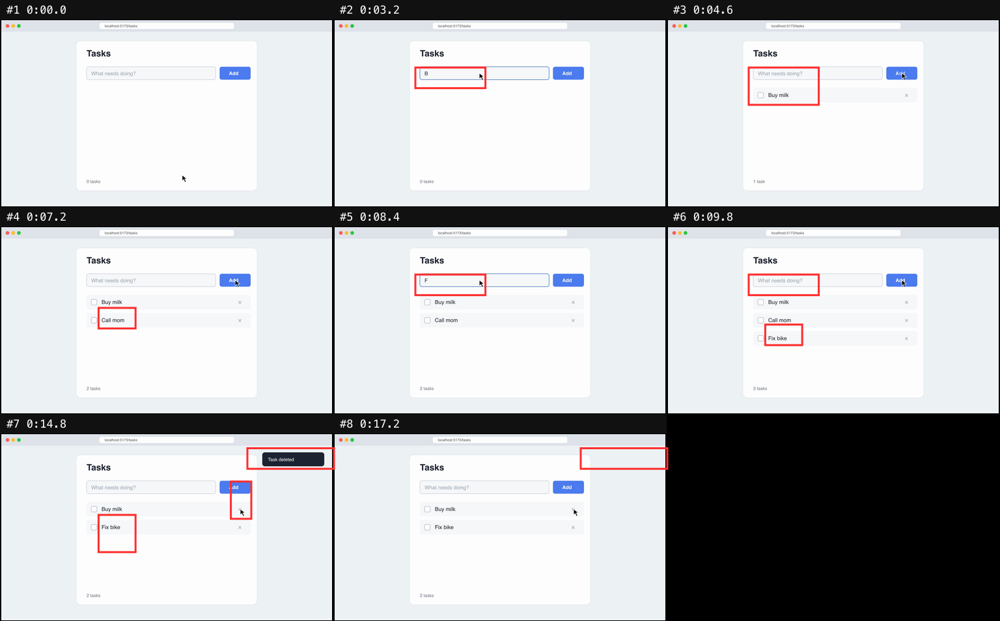

# caught-in-4k

**Your agent said "done ✅". It never watched it run.**

Agents write UI they've never seen move. They can't watch video, so flicker,
frozen animations and layout jumps ship with a confident "looks good!".
caught-in-4k turns a recording into something an agent *can* see, so it catches
its own UI bugs before you do.



*21 seconds of a bug repro, as one image. Red boxes mark what changed. At #7 the
user deletes "Buy milk", but "Call mom" disappears instead.*

```
$ npx caught-in-4k demo-bug.mp4
8 keyframes, 1 sheet(s) in 1.0s
read this first: .caught-in-4k/demo-bug/index.md
```

## How an agent uses it

1. Record the UI: a bug repro, a Loom, or the agent's own change running.
2. The agent calls `watch_video` and gets the sheets plus a timeline of what
   changed, where, and what was said.
3. It zooms into anything suspicious with `zoom_video`, fixes the code, and
   watches a fresh recording to confirm the fix.

## What it does

- **Picks the frames that matter.** One frame per action, once the screen settles:
  the result of a click, not every letter typed on the way. Blank fade-ins are skipped,
  and long recordings stay evenly covered.
- **Catches flicker.** A 60 fps pass finds flashes that last one frame and snap back,
  and marks them `FLICKER`. A model sampling video at 1 fps misses them.
- **Boxes what changed** since the previous frame, so the agent knows where to look.
  Mouse jitter and full-screen cuts are left unboxed.
- **Sharp crops on big screens.** On a Retina recording, the changed areas are cut
  from the full-resolution frame, so small UI text stays readable.
- **Lines up speech** with the frames, using whisper.cpp word timing.
- **Zoom.** Dense frames across any time range, or one full-resolution frame.
- **Cheap.** A 21-second repro fits in one image, about 2k tokens.

Everything runs locally. Nothing is uploaded.

## Give it to your agent

**MCP** (tools `watch_video` and `zoom_video`, images come back inline):

```bash
claude mcp add caught-in-4k -- npx -y caught-in-4k mcp
```

Codex (`~/.codex/config.toml`):

```toml
[mcp_servers.caught-in-4k]
command = "npx"
args = ["-y", "caught-in-4k", "mcp"]
```

Cursor and others (`mcp.json`):

```json
{ "mcpServers": { "caught-in-4k": { "command": "npx", "args": ["-y", "caught-in-4k", "mcp"] } } }
```

**Skill:** copy [`SKILL.md`](SKILL.md) to `~/.claude/skills/caught-in-4k/SKILL.md`
(or your agent's skills folder). The agent then runs it whenever there's a video.

**By hand:**

```bash
npx caught-in-4k bug.mov                           # .caught-in-4k/bug/index.md + sheets
npx caught-in-4k zoom bug.mov --from 0:13.8 --to 0:15
npx caught-in-4k zoom bug.mov --from 14.8 --count 1
```

## Does it work?

We ran a blind test on 6 public bug-report recordings from Excalidraw, Zed and
VS Code against [mcp-video-analyzer](https://github.com/guimatheus92/mcp-video-analyzer).
Separate judge agents saw only one tool's output, with no tool names and no issue text.

| | caught | partial | tokens (6 videos) |
|---|---|---|---|
| caught-in-4k | 2 | 2 | 33k |
| mcp-video-analyzer | 0 | 2 | 54k |

To be honest about it:
- In round 1, before our fixes, mcp-video-analyzer caught 1 and we caught 0.
- The fixes (flicker pass, sharp crops) were tuned on these same videos, so round 2 flatters us.
- Both tools are weak on a first pass without the user's description.

The table above is round 2. Full method, both rounds and caveats are in
[bench/](bench/RESULTS-2026-10-17.md).

## Roadmap

Not built yet:

- [ ] `record <url> --do "click Add, type milk"`: the agent records its own app with Playwright.
- [ ] `check`: pass/fail with an exit code (flicker, frozen animation, layout jump,
      blank screen), so agents and hooks can loop until clean.
- [ ] Motion summary for continuous animations: how much moves, where, how smoothly.
- [ ] A Claude Code hook that won't let the agent stop until the check passes.
- [ ] A GitHub bot that records PR preview builds and comments what it caught.

## Requirements

- Node 20+ and ffmpeg (`brew install ffmpeg`)
- Speech (optional): whisper.cpp (`brew install whisper-cpp`) and a ggml model in
  `~/.cache/caught-in-4k/`, or set `CAUGHT_WHISPER_MODEL=/path/to/ggml-small.en.bin`
- URLs (optional): `yt-dlp`

## Develop

```bash
npm install
npm test     # renders a narrated bug-repro video, then drives the MCP server over stdio
```

MIT licensed.
